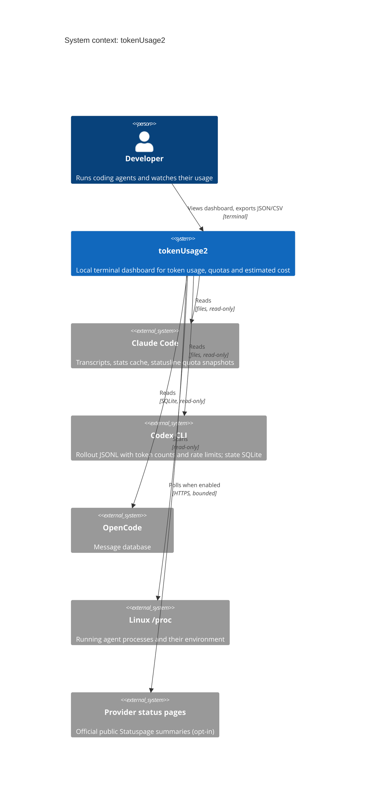
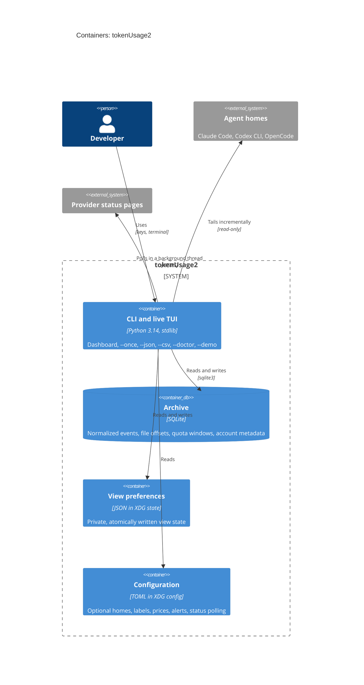
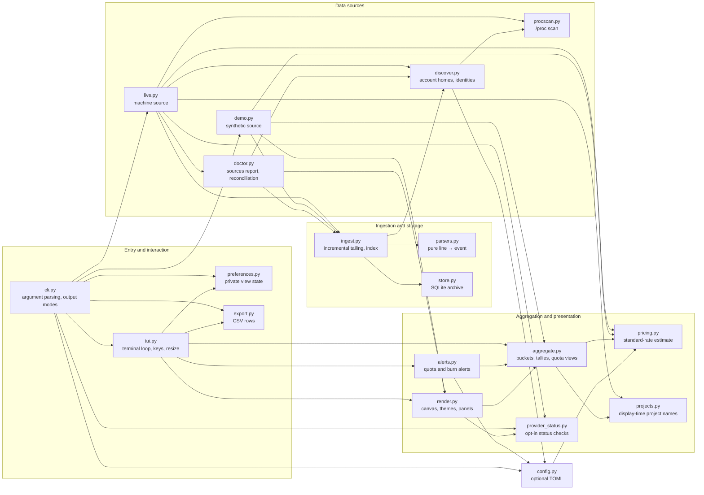
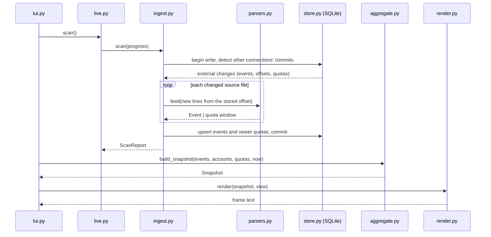
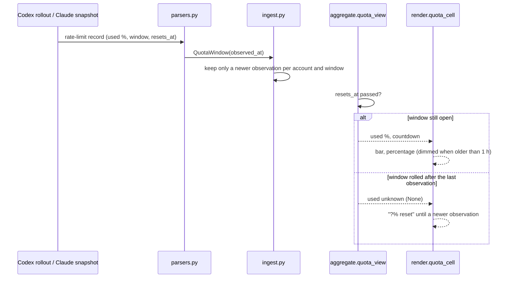

<!--
SPDX-FileCopyrightText: 2026 Marcel Petrick

SPDX-License-Identifier: GPL-3.0-or-later
-->

# tokenUsage2 architecture

This document describes tokenUsage2 in the [C4 model](https://c4model.com/)
style: system context, containers, components and two runtime flows. The
diagrams use Mermaid, which GitHub renders directly. The module list in
[`PLAN.md`](../PLAN.md#4-architecture) stays the short reference; this page
explains how the parts fit together.

## Design constraints

- Python 3.14 and the standard library are the whole runtime; there are no
  third-party runtime dependencies.
- Agent-tool directories are read-only inputs. tokenUsage2 writes only its own
  SQLite archive, exports and private view preferences.
- Prompt and response bodies, credentials and authentication tokens are never
  stored or shown. Parsers keep usage metadata only.
- Archived events are append-preserving. Labels, project names and prices are
  resolved at display time, so a presentation change never rewrites history.
- Rendering produces plain strings on a cell canvas, so every frame can be
  tested without a terminal.

## Level 1: system context

The only network access is the opt-in provider-status poll, which sends no
credentials or user data. Status badges summarize public components; they do
not prove that an authenticated API path works.

## Level 2: containers

Several dashboards may share one archive. Each writer takes the write lock,
detects commits by other connections, and refreshes its cached events, file
offsets, quotas and account metadata before applying further updates.

## Level 3: components

Arrows point from a module to the modules it imports. `model.py` (plain data
types) and `keys.py` (record-key spelling) are shared by most modules and are
omitted for readability.

Responsibilities follow one rule: input-side modules (parsers, ingest, store)
never format anything, and output-side modules (aggregate, render) do no I/O.
`aggregate.py` turns the sorted event list into one immutable `Snapshot` per
frame; `render.py` draws that snapshot onto a cell canvas and emits ANSI or
plain text.

## Runtime flow: one refresh

A file is skipped while its inode, size and modification time are unchanged.
Growing files are read from their last offset; replaced or truncated files
are read again from the start. Record keys make every re-read idempotent.

## Runtime flow: quota windows

A provider reset time alone does not prove how much of the new window is
already spent, so the dashboard never infers `0%`. In the case that prompted
this rule, Codex logged 80% weekly use and then only window-less `premium`
limit records while it refused work after the reported reset time.

## Quality gates

`localPipeline.sh` is the single local, CI and release gate. It requires line
coverage and branch coverage of at least 99% each, Ruff lint and format checks,
ShellCheck, the generated-history check, a demo smoke frame and a clean-wheel
install. Mutation testing with mutmut measures how many injected source faults
the tests detect; see the [README](../README.md#development) for the bar and
how to run it.
